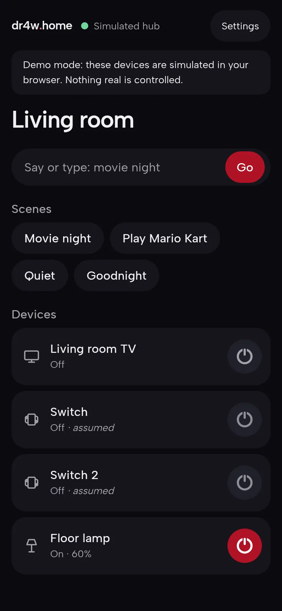
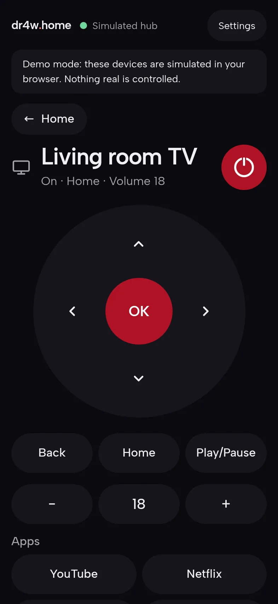
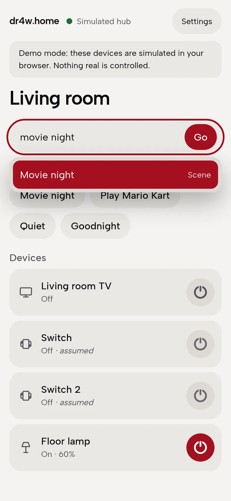
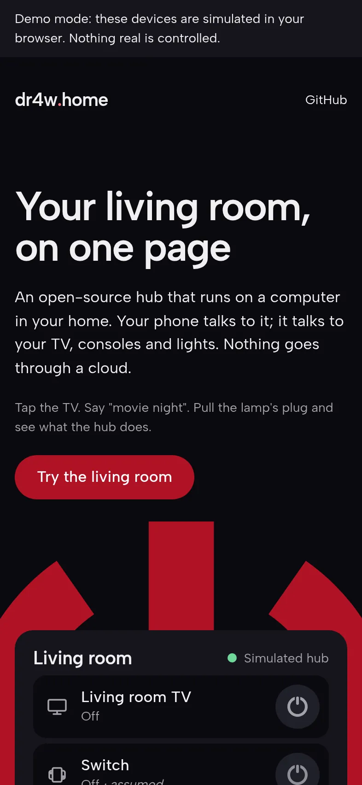

# dr4w home

An open-source home hub you run yourself. One page on your phone shows what is on in your living room
and controls it: tap the TV, or type "movie night". The hub runs on a computer in your home and talks to
each device in its own protocol. Nothing goes through a cloud.

**Try it without installing anything: <https://home.dr4w.io>** (simulated devices, in your browser).

<p>
  
  
  
  
</p>

## Quickstart
```bash
git clone https://github.com/Dr4wOne/dr4w-home && cd dr4w-home
pnpm install
pnpm dev:demo        # the full app on a simulated living room
```
Then connect your own TV in about 30 minutes: [docs/quickstart.md](docs/quickstart.md).

## What it does
- **Your devices on one page,** with the state each device reported back, not a guess. Values a device
  cannot report are marked as assumed.
- **Scenes:** "Movie night" turns the TV on, opens an app and sets the volume, in one tap or one sentence.
- **Safe by design:** every adapter has a block-list of commands it never sends; risky ones ask first.
- **Private:** no public address; away from home you use your own VPN ([remote access](docs/remote-access.md)).
- **Easy to extend:** one small package per device type, with a recipe and a scaffold
  ([add a device](docs/add-a-device.md)).

## Works with
| Device | Status |
|---|---|
| Android TV and Google TV | Works (verified on a Philips Android TV) |
| Nintendo Switch, Switch 2 | Planned |

Details: [docs/compatibility.md](docs/compatibility.md). No logos are used; product names only say what
the kit works with. It is not affiliated with or endorsed by any device maker.

## Docs
[Quickstart](docs/quickstart.md) · [Architecture](docs/architecture.md) · [Hub API](docs/api.md) ·
[Add a device](docs/add-a-device.md) · [Remote access](docs/remote-access.md) ·
[Security and privacy](docs/security.md) · [Decisions](docs/decisions/README.md) ·
[Contributing](CONTRIBUTING.md)

## Licence
MIT, copyright Dr4w. Part of [dr4w.io](https://dr4w.io); the story behind it is on the
[blog](https://blog.dr4w.io).
