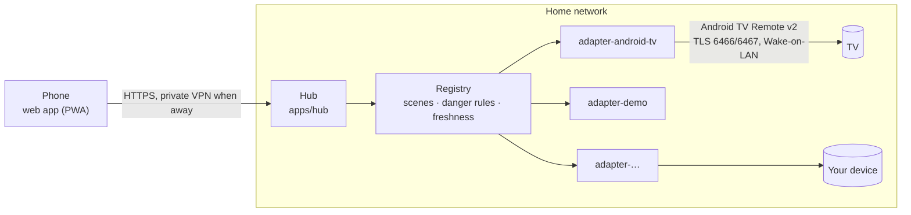
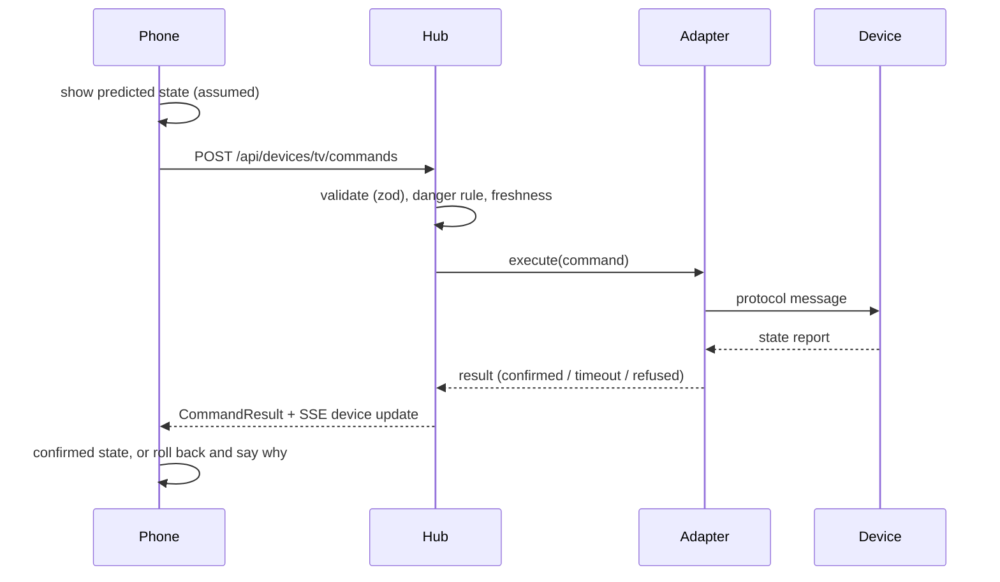

# Architecture

One page on the phone, one hub at home, one adapter per kind of device.

## Parts
| Part | Job | Does not |
|---|---|---|
| Web app (`apps/web`) | Shows devices and scenes, sends commands, shows what the device confirmed | Talk to devices; store anything but a session cookie |
| Hub (`apps/hub`) | Loads adapters from the local config, routes commands, enforces danger rules, runs scenes, streams state | Open any port to the internet; call any cloud service |
| Adapter (`packages/adapter-*`) | Speaks one device protocol; reads state back after each command; owns its block-list | Know about other devices or the UI |
| Device SDK (`packages/device-sdk`) | The contract every adapter implements, the capability types, the schemas | Depend on Node or the browser |
| Showcase (`apps/showcase`) | The same web app on simulated devices, fully in the browser | Have a backend, keys, or any network call |

## A command, end to end

## Capability model
Devices are lists of typed capabilities (power, volume, mute, keypad, app launcher, input source,
activity, light level, light colour, gamepad). The model borrows from Matter clusters and Home
Assistant entities; the mapping is in [capability-model.md](capability-model.md). Every value records
whether the device reported it or the hub assumed it, and when. The UI is generated from capabilities.

## State you can trust
- **Read-back.** An adapter reports a command as `confirmed` only when the device's own report
  matches. Devices that cannot report (consoles over HDMI-CEC) are marked `assumed` everywhere.
- **Freshness.** State older than the adapter's freshness window is treated as unknown, and the
  adapter re-reads before acting. (This exists because a session once kept reporting a TV as off while
  it was on.)
- **Danger.** Each adapter classifies every command as `none`, `confirm` or `blocked`. Blocked commands
  never leave the hub; `confirm` needs the person to say yes in the app.

## Where things live
| Thing | Where |
|---|---|
| Code, docs, scrubbed fixtures, example config | This repository |
| Your config, device credentials, scenes, raw recordings, deny-list | `~/.config/dr4w-home/` on the hub machine (mode 0700), never in the repo |
