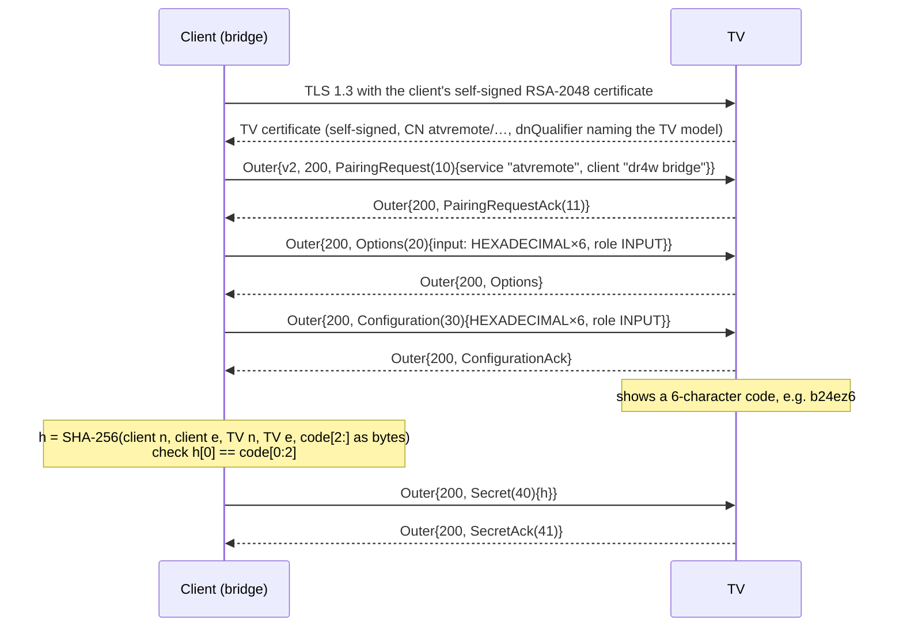

# Protocol: Android TV Remote v2

Evidence recorded on a Philips-branded Android TV (Android TV OS 11) on a home network; addresses and
identifiers are left out.
It is controlled through Google's **Android TV Remote v2** service
(`com.google.android.tv.remote.service`): TLS 1.3 with client certificates on
ports **6467** (pairing) and **6466** (control), carrying length-prefixed protobuf messages.
Implementation: `packages/android-tv-remote`. Evidence: recorded sessions in
`packages/android-tv-remote/fixtures/` (checked 2026-10-16). Starting leads were the open-source
`androidtvremote2` library (Home Assistant); every row below was verified against this TV unless
marked otherwise.

## Framing
Every message on both ports: `varint(length) ‖ protobuf body`. Bodies are decoded with the field
numbers below (`src/proto.ts`, `src/remote.ts`).

## Pairing (port 6467, once per client)

`n` and `e` are the RSA modulus and exponent as unsigned big-endian bytes (`e` = `01 00 01`).
A wrong code fails locally (first hash byte) before anything is sent. Status 402 = bad secret.
The client then stores the TV's certificate and refuses any later connection whose certificate differs.

## Control session (port 6466)
| Step | TV → client | Client → TV |
|---|---|---|
| 1 | `1 RemoteConfigure {1: features 639, 2: {model "4K SMART TV", vendor "…", package, version}}` | `1 RemoteConfigure {1: 615, 2: {dr4w device info}}` |
| 2 | `2 RemoteSetActive {}` | `2 RemoteSetActive {1: 615}` |
| 3 | start-up burst: `50` volume, `40` power, `20` current app | — |
| — | `8 RemotePingRequest {1: n, 2: t}` every ~5.2 s | `9 RemotePingResponse {1: n}` (else the TV drops the session) |

Features 615 = ping 1 + key 2 + IME 4 + power 32 + volume 64 + app link 512 (no voice).
**Keys sent within ~200 ms after the start-up burst are silently ignored** (6 of 8 traced connections);
the client waits 400 ms after it (0 of 10 dropped).

## Capability matrix
| Capability | Message | Read-back | Result on this TV | Evidence | Confidence |
|---|---|---|---|---|---|
| Power state | TV sends `40 RemoteStart {1: 1 on / 0 off}` | itself | ✅ on/off reported | runtime | high |
| Power off | key `POWER` (26) | `40 {1: 0}` | ✅ confirmed in 2.0 s | runtime | high |
| Power on, light standby | key `WAKEUP` (224) | `40` | ❌ ignored | runtime | high |
| Power on, session still open | key `POWER` (26) | `40 {1: 1}` | ✅ TV on in 2.8 s; with the bridge's session open the TV stayed reachable in standby for over 180 s | runtime | high |
| Power on, deep standby | **Wake-on-LAN** to the TV's MAC address (UDP 9, broadcast) | `40 {1: 1}` after reconnect | ✅ TV on, port open within 1 s, nobody touched the remote | runtime | high |
| Volume up/down | keys 24 / 25 | `50 {6: max 100, 7: level, 8: muted}` | ✅ 100/100, p50 51 ms, p95 64 ms | runtime (`fixtures/latency-lan.json`) | high |
| Mute | key `VOLUME_MUTE` (164) | `50 {8}` | ✅ on 216 ms, off 88 ms | runtime | high |
| Set absolute volume | `50 RemoteSetVolumeLevel` from the client | `50` | not tried (repeat keys instead) | lead | low |
| Home / back / menu | keys 3 / 4 / 82 | `20` app → `com.google.android.apps.tv.launcherx` | ✅ Home in 453 ms | runtime | high |
| D-pad + OK | keys 19–23 | none (no message) | ✅ cursor moved (confirmed on the TV screen) | runtime + eyes | high |
| Current app | TV sends `20 RemoteImeKeyInject {1: {12: package}}` | itself | ✅ Disney+, YouTube, launcher seen | runtime | high |
| Launch app by link | `90 RemoteAppLinkLaunchRequest {1: "https://www.youtube.com"}` | `20` app | ✅ YouTube in 1.3 s | runtime | high |
| Launch app by package | `90 {1: "market://launch?id=<package>"}` | — | ❌ **the TV closes the session**; refused by the client | runtime | high |
| Inputs (HDMI 1–4, input menu) | keys 243–246, 178 | `20` app (TV input app) | not yet run | lead | medium |
| Channels, numbers, media keys, guide, info, captions | keys 166/167, 7–16, 85–90, 126/127, 172, 165, 175 | none for most | not yet run | lead | medium |
| Text entry | `21 RemoteImeBatchEdit` | — | out of scope v1 | lead | low |
| Picture / sound modes, Ambilight | — | — | **not available**: no messages in this protocol; no JointSPACE on this TV | discovery | high |
| Now playing (title, position) | Cast `urn:x-cast:com.google.cast.receiver` on 8009 | — | not yet probed | lead | low |

## Never send
Enforced twice in `src/keys.ts`: an allow-list of named keys, then a block-list of codes.
- `KEYCODE_SETTINGS` (176): system settings, where factory reset and network setup live.
- `KEYCODE_ASSIST` (219), `KEYCODE_VOICE_ASSIST` (231), `KEYCODE_SEARCH` (84): open the microphone.
- `KEYCODE_ALL_APPS` (284), `KEYCODE_TV_NETWORK` (241), `KEYCODE_SOFT_SLEEP` (276).
- Any message type other than configure, set active, ping response, key inject, app link.
- App links other than `https://…` (a `market://` link makes the TV drop the session).
- Nothing on 8443 (Cast setup), and no Cast/DIAL commands that change device settings.

## Unknowns (kept honest)
- Answered: `POWER` turns the TV on while the session is open, so the bridge uses `POWER` when the
  session is open and the TV reports off, and Wake-on-LAN otherwise.
- What ports 9000 and 56789 serve (TCP accepts; no HTTP).
- Whether the TV's IP changes on DHCP renewal (the bridge rediscovers by MAC via mDNS/ARP).
